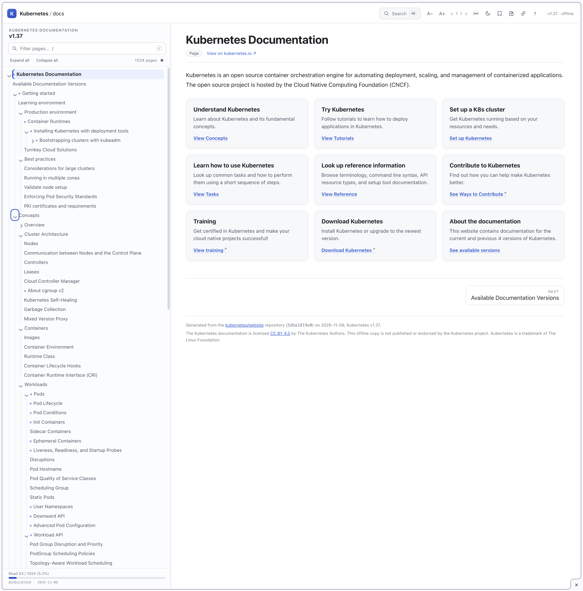
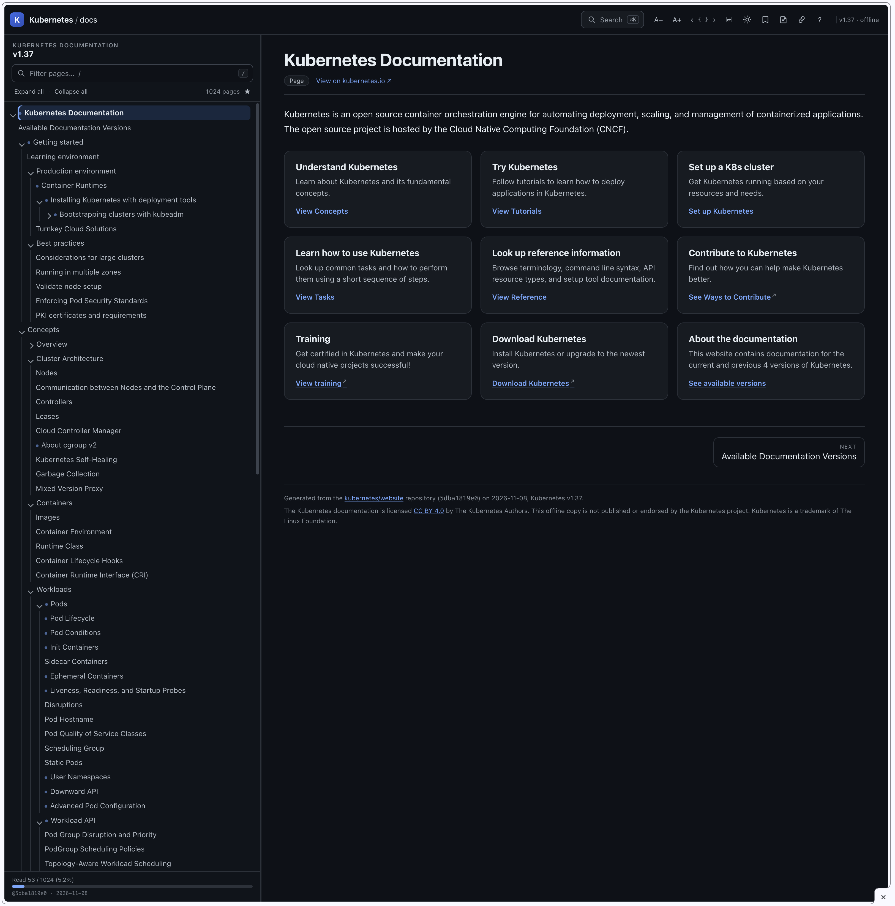
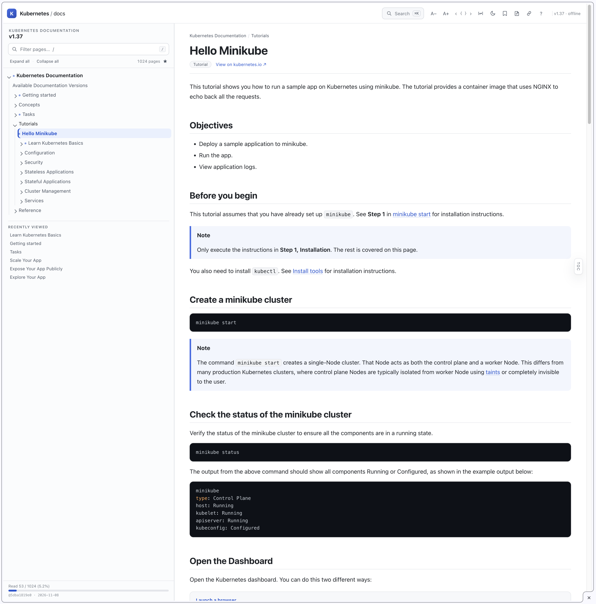

# Kubernetes Documentation — Offline Edition


A complete, self-contained copy of the English Kubernetes documentation
(**Kubernetes v1.37**) that runs from a local folder — no web server, no network
access, no build step. Open `index.html` and read.

The site is generated from the official
[kubernetes/website](https://github.com/kubernetes/website) sources, so it contains
the same documentation as [kubernetes.io/docs](https://kubernetes.io/docs/):
every concept, task, tutorial, setup page, the full API reference, and the whole
`kubectl` reference.

> **Scope:** 1,024 pages of user documentation. The contributor guide
> (`/docs/contribute/`) is not included.

| Light theme | Dark theme |
|:---:|:---:|
| [](https://github.com/icfsy/kubernetes-website-offline/raw/main/images/home-light-theme.png) | [](https://github.com/icfsy/kubernetes-website-offline/raw/main/images/home-dark-theme.png) |

## Highlights

- **1,024 pages, fully offline** — one `index.html`, one `docs/` tree, one
  `assets/` folder. No fonts, scripts, styles or images are loaded from the
  internet, and there is no analytics or tracking.
- **Everything included** — Concepts, Tasks, Tutorials, Setup, and the complete
  Reference: Kubernetes API reference, `kubectl` command reference (all 44
  commands and their subcommands), glossary, component tools, feature gates and
  much more.
- **Full-text search** — instant page-title matches plus a full-text index
  (≈11 MB, loaded lazily) and a **kubectl flag index** (4,824 flags). Search for
  `--dry-run` and jump straight to the commands that support it.
- **Offline links** — cross-references between pages are real relative links;
  links to pages outside the documentation open kubernetes.io; glossary links go
  to the offline glossary page.

### Navigation

- A 1,000+ item tree of the entire documentation.
- The path to the page you are reading is expanded automatically, the current
  page is highlighted, and an already-collapsed tree never hides it.
- Filter by page title (`/`), expand/collapse all, visited-page markers and a
  “Recently viewed” list.
- The sidebar width is draggable and remembered; double-click the splitter to
  reset it.


### Reading tools

- **On this page** outline with scroll-spy. It can be **docked**, **floating**
  (overlay, content stays full-width) or **hidden** (the article then uses the
  full window width; a small `TOC` tab brings it back).
- Per-page scroll position memory, previous/next page (`[` / `]`), and a reading
  progress indicator.
- Text size, wide-content layout, and a dark theme — all remembered.
- Print-friendly styles.
- Bookmarks (`Alt+B`) and per-page notes stored in the browser (`Alt+N`);
  notes can be exported as Markdown.

### Code blocks

- Syntax highlighting for shell, YAML, JSON, Go, PowerShell and more.
- **13 code-block presets** (Auto + 12 themes), switchable with the two `‹ { } ›` buttons in the top
  bar (or `Alt+[` / `Alt+]`): *Auto* (follows the page light/dark theme), GitHub
  Light/Dark, Atom One Light/Dark, Nord, Monokai, Solarized Light/Dark, Zenburn,
  Visual Studio Light, Xcode and Tokyo Night.
- Copy buttons on code blocks strip shell prompt prefixes where present.
- Highlighting is powered by [highlight.js](https://highlightjs.org/)
  (BSD-3-Clause, bundled locally under `assets/vendor/`).

[](https://github.com/icfsy/kubernetes-website-offline/raw/main/images/code-block.png)

## Quick start

```bash
git clone https://github.com/icfsy/kubernetes-website-offline.git
cd kubernetes-website-offline
open index.html          # macOS
# xdg-open index.html    # Linux
# start index.html       # Windows
```

The page works from `file://`. If your browser restricts local files, serve the
folder instead — no build is needed:

```bash
python3 -m http.server 8000
# then open http://localhost:8000/
```

## GitHub Pages

This repository is already a ready-to-publish static site (`.nojekyll` included).
To publish it:

1. Open **Settings → Pages**.
2. Under **Build and deployment**, choose **Deploy from a branch**.
3. Select branch **`main`** and folder **`/ (root)`**, then **Save**.

The site will be available at
<https://icfsy.github.io/kubernetes-website-offline/>. Every push to `main`
publishes the updated site automatically.

## Repository layout

```
.
├── index.html          # entry point (redirects to docs/home.html)
├── docs/               # 1,024 documentation pages
├── assets/
│   ├── site.css        # layout, themes, typography
│   ├── site.js         # navigation, search, outline, notes, bookmarks
│   ├── nav.js          # page tree data
│   ├── flags.js        # kubectl flag index (for search)
│   ├── search/         # full-text index chunks (lazy-loaded)
│   ├── code-themes/    # 13 highlight.js theme stylesheets
│   └── vendor/         # highlight.js bundle + license
├── .nojekyll           # disable Jekyll on GitHub Pages
└── README.md
```

## Keyboard shortcuts

| Keys | Action |
|---|---|
| `/` | Filter pages in the sidebar |
| `⌘K` / `Ctrl K` | Search all documentation |
| `[` / `]` | Previous / next page |
| `Alt B` | Bookmark the current page |
| `Alt N` | Open notes for the current page |
| `Alt T` | Toggle dark mode |
| `Alt +` / `Alt −` | Increase / decrease text size |
| `Alt [` / `Alt ]` | Previous / next code-block theme |
| `?` | Show all shortcuts |
| `Esc` | Close search and panels |

## Scope and versions

| | |
|---|---|
| Documentation version | Kubernetes **v1.37** |
| Upstream source | `kubernetes/website` @ `5dba1819e0` |
| Pages | 1,024 |
| Size | ≈56 MB (1,192 files) |
| Language | English |
| Search index | ≈11 MB, lazy-loaded |
| Code-block presets | 13 (Auto + 12 themes) |

## Known differences from the website

- The documentation is a static snapshot; it is not updated automatically.
- This repository holds the generated static site only; the generator used to
  build it is not included here.
- Tabbed code samples (e.g. POSIX / Windows) are shown one after another, each
  with a label, instead of being switchable.
- Some cross-page anchors that no longer exist upstream are dropped (the link
  still opens the target page); the same links are broken on kubernetes.io.
  In-page links whose anchor no longer exists point to the top of the page.
- Pages with more than 60 headings (some API reference pages) do not show the
  right-hand outline; the article still uses the full width.
- Bookmarks, notes, reading progress and preferences are stored in the browser’s
  `localStorage`. They stay with the browser, not with the folder; moving the
  folder keeps the content working but may not carry this local data.

## Credits and license

- **Documentation** — the Kubernetes documentation is licensed
  [CC BY 4.0](https://creativecommons.org/licenses/by/4.0/) by
  The Kubernetes Authors. This repository is an offline copy of the same content.
- **Highlighting** — [highlight.js](https://highlightjs.org/) and its themes are
  BSD-3-Clause; see `assets/vendor/highlight.LICENSE.txt`.
- **Trademarks** — Kubernetes and the Kubernetes logo are trademarks of
  The Linux Foundation. This offline edition is not published or endorsed by the
  Kubernetes project, CNCF or The Linux Foundation.
